# Tape Pool

**Bridge your rig to X Layer and borrow against what it will mine.**

Tape Pool is a BEM lending pool on [X Layer](https://web3.okx.com/xlayer) for TapeOut miners. Built for the OKX X Layer
Build X "TapeOut Accelerate" hackathon.

- **App:** [app.tapepool.io](https://app.tapepool.io)
- **Website:** [tapepool.io](https://tapepool.io)

What it does:

- **Lenders** deposit BEM and receive **tpBEM**, an ERC-4626 share whose value grows with the fees borrowers pay.
- **Borrowers** are miners who bridged a TapeOut rig to X Layer. They move the rig's RIG voucher into their own agent
  contract and take a BEM advance for 7 or 14 days.
- **Repayment is automatic.** While the agent holds the voucher, every harvest of the rig pays its BEM to the agent.
  Anyone can sweep that BEM into the pool: the fee first, then the principal. When the debt is cleared, the borrower
  takes the voucher back.
- **The credit rule is a public TapeOut circuit.** Whether an advance is allowed is decided by a NAND circuit taped out
  on X Layer and evaluated on-chain. Anyone can read and verify the rule, and no one can change it quietly.
- **No auctions, no price oracle.** The debt is in BEM and is repaid in BEM, so the BEM price never triggers a
  liquidation. A slow rig is never seized. A loan is closed by force only if the rig itself is impaired (revoked,
  stopped or rescued), proven on-chain, after a 72-hour window to repay.

## How TapeOut is used

| TapeOut piece | How Tape Pool uses it |
|---|---|
| TapeOut circuits on X Layer | The credit policy is our own processor, "Tape Pool Policy" (TPPOL), and its circuit #1 (44 NAND gates). `CreditPolicy` calls the circuit's `eval` on every borrow and allows the advance only if the circuit and a Solidity mirror of the rule both say yes |
| RIG vouchers (ERC-721) | The collateral. The borrower's agent holds the voucher during the loan, so the rig's harvests repay the debt |
| PodMining and the rig vault on BSC | The source of each rig's base power, status and pending output, read on BSC and carried to X Layer by our rig data feed (LayerZero) |
| BEM | The pool's asset: deposits, advances, fees and repayments are all in BEM |
| DeWEB / TapeKit | The app builds as a static site ready for DeWEB, in the container of the policy circuit (`app/scripts/deweb.mjs`) |

**Hackathon submission values:** processor Circuits contract `0xdc76f123838b5398A173D215a2c8338Ad189C9a8` (X Layer),
circuit ID **1**.

## Deployed contracts

The live stack was deployed on 2026-11-16: the pool contracts at X Layer blocks 76,074,240–76,074,248, the rig data
feed at BSC block 133,949,050 (reporter) and X Layer block 76,073,325 (receiver). Borrows opened on 2026-11-18.

Every contract below that Tape Pool wrote has its source verified as an exact match on
[Sourcify](https://sourcify.dev), and on the chain's explorer (OKLink for X Layer, BscScan for BSC).

| Contract | Chain | Address | Role |
|---|---|---|---|
| `TapePool` (tpBEM) | X Layer | [`0x1a9A9850D597D8e3a03AFae48E3ac8E2D4aeC9d7`](https://www.oklink.com/x-layer/address/0x1a9A9850D597D8e3a03AFae48E3ac8E2D4aeC9d7) | ERC-4626 vault: asset BEM, share tpBEM. Lends to agents, receives repayments, keeps a loss reserve |
| `AgentFactory` | X Layer | [`0xA9014E27dD17ea30E4Fa4f71934645b9DCEF8ac8`](https://www.oklink.com/x-layer/address/0xA9014E27dD17ea30E4Fa4f71934645b9DCEF8ac8) | Creates a `RigAgent` clone for a borrower |
| `RigAgent` implementation | X Layer | [`0x0D4BA9992B2b887ea1f55E59925339547C772259`](https://www.oklink.com/x-layer/address/0x0D4BA9992B2b887ea1f55E59925339547C772259) | Logic behind every agent clone (EIP-1167) |
| `CreditPolicy` | X Layer | [`0xBBFe498158b6A234f4f63B17673f6e8226656D34`](https://www.oklink.com/x-layer/address/0xBBFe498158b6A234f4f63B17673f6e8226656D34) | Calls the policy circuit with a gas cap and strict decoding; any unexpected result means deny |
| `RigScreen` | X Layer | [`0xc2bBc2f2EC90e16f8a9619D26A51144Eb0AC1744`](https://www.oklink.com/x-layer/address/0xc2bBc2f2EC90e16f8a9619D26A51144Eb0AC1744) | Records each rig's revocation-screen pass (in effect 48 hours after it is recorded) |
| `TapeLens` | X Layer | [`0xFcc669BC9cCa397CB01804035D5Be981d7389ef2`](https://www.oklink.com/x-layer/address/0xFcc669BC9cCa397CB01804035D5Be981d7389ef2) | Read-only helper: how much an agent can borrow right now, and if nothing, why. Holds no state and no funds |
| `RigFeedReceiver` | X Layer | [`0xc94C9Cc912203c29C2c1b3534e0852BF4aFAeA10`](https://www.oklink.com/x-layer/address/0xc94C9Cc912203c29C2c1b3534e0852BF4aFAeA10) | Receives rig reports from BSC over LayerZero and keeps the newest report per rig. Locked: no owner, no delegate |
| `RigReporter` | BSC | [`0xD54673E73448584E86C61f45203ab507F3F2c3eC`](https://bscscan.com/address/0xD54673E73448584E86C61f45203ab507F3F2c3eC) | Reads PodMining and the rig vault on BSC and sends up to 16 rig reports per message. Locked: no owner, no delegate |
| Policy circuit: Circuits (ERC-721) | X Layer | [`0xdc76f123838b5398A173D215a2c8338Ad189C9a8`](https://www.oklink.com/x-layer/address/0xdc76f123838b5398A173D215a2c8338Ad189C9a8) | Processor "Tape Pool Policy" (TPPOL), made with the TapeOut factory; circuit ID 1 is the credit rule |
| Policy circuit: transistors | X Layer | [`0x05264cF3862266165401d3961935D0D230bC8fd6`](https://www.oklink.com/x-layer/address/0x05264cF3862266165401d3961935D0D230bC8fd6) | The processor's transistors contract |

The two policy-circuit contracts run TapeOut's own code, made by the TapeOut factory, so their source is TapeOut's to
publish. Each agent a borrower creates is a minimal proxy of the `RigAgent` implementation; explorers show it through
the verified implementation.

Roles:

| Role | Address | Powers |
|---|---|---|
| Owner | `0x19a953e83C4CFDffFf2Fd336f3857c52D99045ba` | Changes caps and fees within hard bounds in code. Tightening is instant, loosening waits 48 hours, a credit-policy swap waits 7 days. Can never move pool funds or vouchers; `renounceOwnership` is disabled |
| Guardian (keeper) | `0xB61e09c96B66c02D9518e8f0f9Ce645b8589dBC8` | Only reversible brakes: pause new borrows, suspend a rig's screen pass, switch off the data feed. Only the owner releases them |
| Deployer | `0x04974a7F899813dBaf0046469Ea73Ff0a5E352F3` | No role in the pool. Holds the policy circuit NFT |

Parameters, as read from the pool:

| Parameter | Value |
|---|---|
| Terms | 7 days or 14 days |
| Flat fee (the whole cost of the advance) | 0.25% (7 days), 0.5% (14 days) |
| Max debt per rig (advance + fee) | 85% (7 days) or 80% (14 days) of the rig's expected base output over the term |
| Minimum advance / minimum fee | 0.01 BEM / 0.001 BEM |
| Supply cap | 20 BEM |
| Borrow cap | min(8 BEM, 70% of pool assets) |
| Per-borrower cap | min(4 BEM, 40% of pool assets) |
| Loss reserve | 20% of each fee, up to 5% of pool assets |
| Late fee | 0 |
| Operating fee | 0 OKB (sponsored at launch) |

Caps only block new deposits or new borrows; they never block repayments, sweeps or withdrawals. `borrowsPaused()` on
the pool shows whether new borrows are open.

## Architecture

```mermaid
flowchart LR
  subgraph users["Who uses it"]
    lender["Lender<br/>browser wallet"]
    miner["Miner<br/>browser wallet, holds a RIG voucher"]
  end

  app["app.tapepool.io<br/>static web app, signs only<br/>through the user's wallet"]

  subgraph xl["X Layer"]
    pool["TapePool<br/>BEM in, tpBEM out"]
    agent["RigAgent<br/>one per borrower,<br/>holds the RIG voucher"]
    policy["CreditPolicy<br/>policy circuit: TapeOut Circuits #1<br/>screen pass: RigScreen"]
    receiver["RigFeedReceiver<br/>newest report per rig"]
  end

  keeper["Keeper and guardian<br/>off-chain, every 60 s"]

  subgraph bsc["BSC: TapeOut mining"]
    reporter["RigReporter"]
    pod["PodMining and rig vault"]
  end

  lender -->|"deposit, withdraw"| app
  miner -->|"borrow, repay, release"| app
  app -->|"supply BEM, get tpBEM"| pool
  app -->|"create agent, send voucher,<br/>borrow, repay, release"| agent
  app -->|"share price, positions,<br/>report push requests"| keeper

  agent -->|"check each advance"| policy
  policy -->|"reads the rig report"| receiver
  agent -->|"lend: BEM advance to the miner<br/>repay: fee first, then principal"| pool

  keeper -->|"push rig reports"| reporter
  reporter -->|"reads base power, status"| pod
  reporter -->|"LayerZero message"| receiver
  keeper -->|"harvest the loan's rigs"| pod
  pod -->|"mined BEM over the BEM bridge,<br/>paid to the voucher holder"| agent
  keeper -->|"sweep, flag impaired, seize"| agent
```



How a loan runs:

1. The miner creates a `RigAgent`, sends it the RIG voucher and asks for an advance. The agent asks `CreditPolicy`,
   which reads the rig's latest report, its screen pass and the voucher's holder, and evaluates the policy circuit. If
   both the circuit and the Solidity mirror allow it, the pool sends the BEM advance to the miner.
2. While the agent holds the voucher, the keeper harvests the rig on BSC. The harvested BEM crosses the BEM bridge and
   is paid to the voucher's holder, the agent.
3. The keeper (or anyone) calls `sweep`: the agent repays the pool, the fee first and then the principal, and sends
   anything left to the miner. The miner can also repay by hand at any time.
4. When the debt is zero, the miner takes the voucher back with `release`.

## How it works

| Component | Chain | Role |
|---|---|---|
| `TapePool` | X Layer | The lending vault. `maxWithdraw` is capped to idle BEM, so lenders may wait for repayments |
| `RigAgent` | X Layer | Owned by one borrower (a borrower may open several). Holds the borrower's vouchers, borrows, sweeps harvested BEM into the pool, and lets the borrower take the vouchers back (`release`) once the debt is zero. The borrower can also repay by hand at any time (`repay`) |
| `CreditPolicy` + policy circuit | X Layer | Inputs: term, debt-versus-expected-output bucket, data freshness, rig health, processor allow-list, rig age (at least 3 days), revocation screen. Output: allow |
| Rig data feed | BSC → X Layer | The reporter reads each rig's base power and status on BSC and sends them over LayerZero. Both ends are locked after setup, so no key can vouch for rig data |
| Revocation screen | off-chain + X Layer | `screen/` proves a rig matches every official vector of its PodMining task, so it cannot be revoked; the owner records the pass in `RigScreen` |
| Keeper | off-chain | Harvests rigs on BSC on the loan schedule, sweeps agents on X Layer, flags impaired rigs, pushes rig reports for borrowers and alerts the owner. Holds gas only, never pool funds |
| App | browser | Static web app (TypeScript, Vite, viem). Reads the contracts through public RPCs and signs only through the user's own wallet |

## Repo layout

```
app/             web app (see app/README.md)
keeper/          off-chain keeper and guardian (see keeper/README.md)
screen/          revocation screen tool and the committed screen artifacts (see screen/README.md)
src/             contracts: TapePool, AgentFactory, RigAgent, CreditPolicy, RigScreen, TapeLens
src/feed/        BSC reporter and X Layer receiver of the rig data feed
src/libraries/   CreditMath (term table, expected output), PolicyV1 and NetlistBuilder (the policy circuit)
src/interfaces/  interfaces of the live X Layer, BSC and LayerZero contracts
src/spike/       feasibility spike, reference only (some fork tests reuse its helpers)
script/          Forge deploy and check scripts (dry run unless --broadcast is passed)
test/            unit, fuzz, invariant and fork tests
docs/security-audits/  the latest security review of the contracts
```

## Run the app

Node 22 or newer.

```bash
cd app
npm ci --ignore-scripts
VITE_NETWORK=redeploy npm run dev       # then open http://localhost:5173/#/app
```

`VITE_NETWORK=redeploy` selects the live stack above; the default `mainnet` book is an earlier stack, so always build
with `redeploy`. You can also put `VITE_NETWORK=redeploy` (and optionally `VITE_KEEPER_URL=<keeper base URL>`) in `app/.env.local`,
which is git-ignored.

Production build: `VITE_NETWORK=redeploy npm run build` writes a static site to `app/dist/`. The hosted app at
[app.tapepool.io](https://app.tapepool.io) is built this way from `app/`. Hosting, the Content-Security-Policy and
DeWEB publishing are described in [app/README.md](app/README.md).

## Build and test the contracts

Requires [Foundry](https://book.getfoundry.sh/) 1.5.1 and Node.

```bash
git clone --recurse-submodules https://github.com/TapePool/TapePool-Dapp.git
cd TapePool-Dapp
npm ci --legacy-peer-deps --ignore-scripts   # LayerZero OApp sources, remapped from node_modules
forge build
forge test
forge fmt --check
```

Unit tests run on mocks. Fork tests fork X Layer through its public RPC at block 73,558,380 (`FORK_BLOCK` overrides it).
The BSC suites need an archive endpoint in `BSC_RPC`, kept in a local `.env` file that is never committed; without it they
skip. Tests never send a transaction to a live chain.

The deployed contracts were compiled with solc 0.8.24, optimizer on at 200 runs, EVM version Cancun; the verified
sources on the explorers show the same settings.

## Security review

[docs/security-audits/2026-11-05-redeploy-4-prescan.md](docs/security-audits/2026-11-05-redeploy-4-prescan.md) is the
team's latest review of the deployed contracts and their deployment gates. It was done by the Tape Pool team with
AI-assisted scanning and triage, and it is not independent. After the hackathon we plan a third-party audit.

## License

[MIT](LICENSE).
